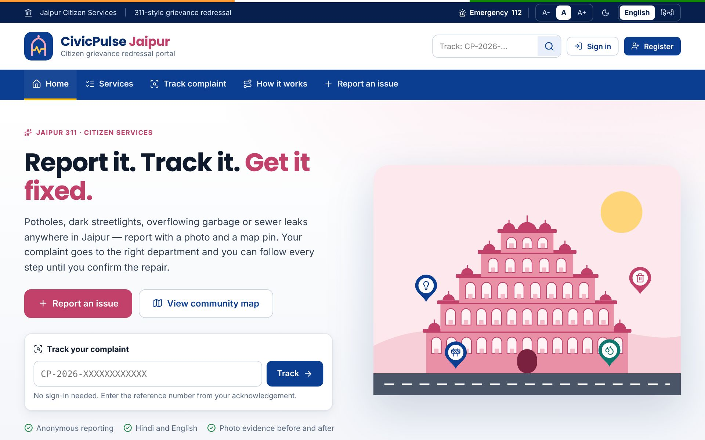
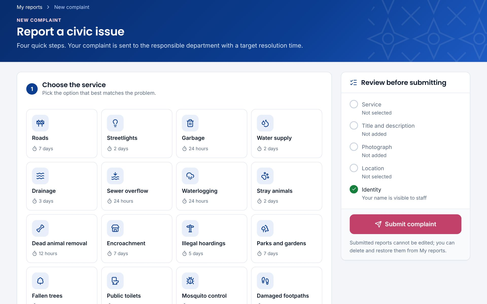
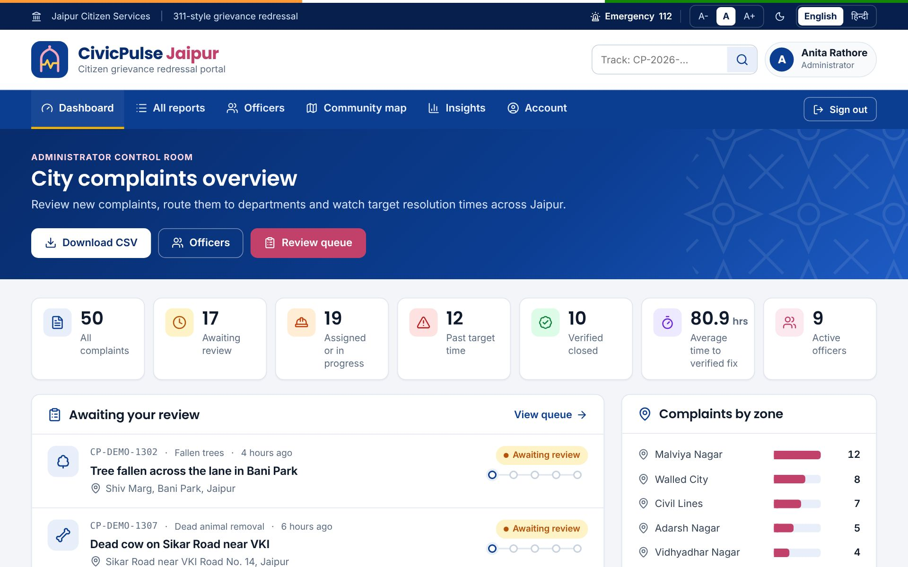
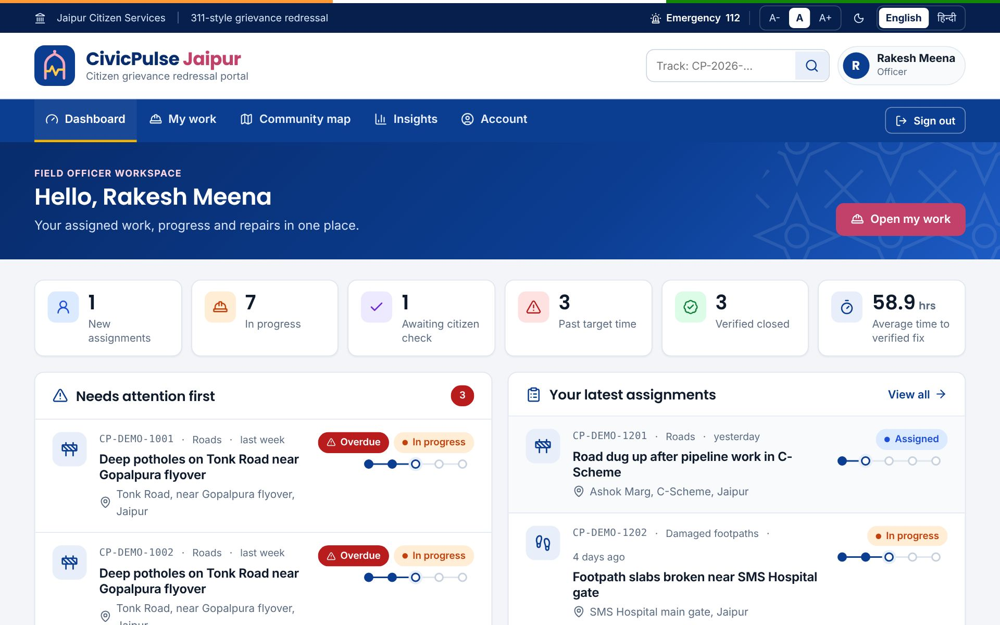
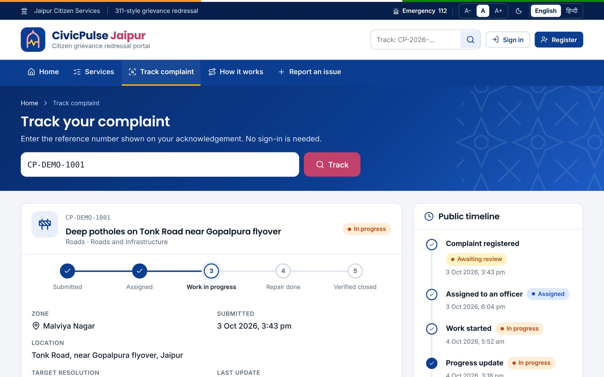
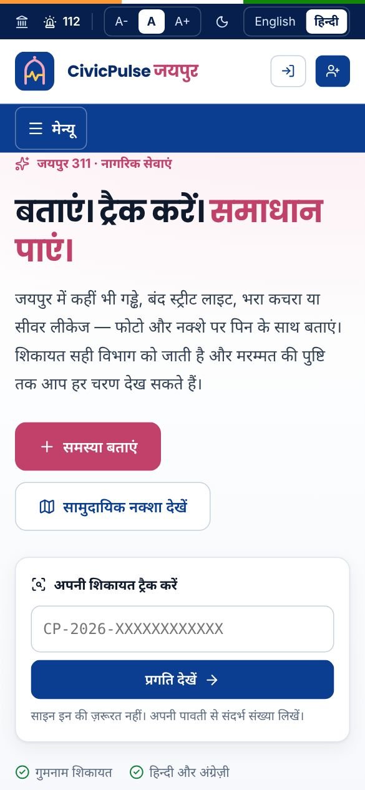
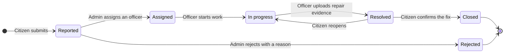
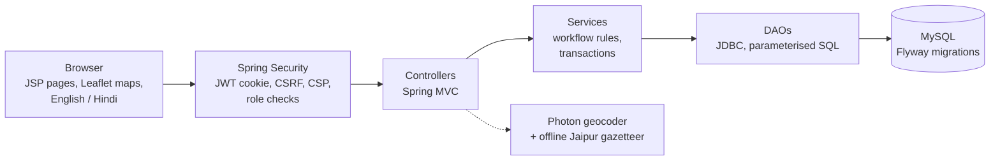

# CivicPulse Jaipur

**Live demo:** https://civicpulse-53ga.onrender.com/login

| Role | Email | Password |
|---|---|---|
| Citizen | citizen@civicpulse.test | `citizen@1234` |
| Officer | officer@civicpulse.test | `officer@1234` |
| Admin | admin@civicpulse.test | `admin@1234` |

The site runs on Render's free plan and sleeps after 15 minutes without visitors, so the first visit can take a minute or two to load.

**Project documents**

| Document | Link |
|---|---|
| Project report | [View on Google Drive](https://drive.google.com/file/d/19K7T9EtAepqIm7ngM82QmIAlpn6WgDLG/view?usp=drive_link) |
| Abstract | [View on Google Drive](https://drive.google.com/file/d/11aNrVOPMRHmJ4IQpY-zVANVPaQFdENSx/view?usp=drive_link) |
| Research paper | [View on Google Drive](https://drive.google.com/file/d/1FzdvwbPmxXjHJS5c6rZ7UDYvJ0AMuwfr/view?usp=drive_link) |
| Demo video | Coming soon |

---

**A Jaipur 311-style citizen grievance redressal portal.** Citizens report civic problems with a photo and a map pin, the city routes each complaint to the responsible department, an officer repairs it, and the citizen confirms the fix. Every step is tracked publicly, in English and हिन्दी.


## Contents

1. [About the project](#about-the-project)
2. [Screenshots](#screenshots)
3. [Features](#features)
4. [Complaint lifecycle](#complaint-lifecycle)
5. [Service catalogue](#service-catalogue)
6. [Anonymous reporting](#anonymous-reporting)
7. [Tech stack](#tech-stack)
8. [Architecture](#architecture)
9. [Project structure](#project-structure)
10. [Database](#database)
11. [Security](#security)
12. [Run locally](#run-locally)
13. [Testing](#testing)
14. [Team](#team)
15. [Documentation](#documentation)
16. [Credits](#credits)

## About the project

### The problem

Complaints about potholes, dark streetlights, overflowing garbage or sewer leaks are often made by phone or on paper, and they get lost between citizens and departments:

- **No visibility.** Citizens never learn who is handling their complaint, or when it will be fixed.
- **Closures without proof.** Tickets are marked resolved without any evidence that the repair happened.
- **Duplicate reports.** The same pothole is reported again and again as separate tickets, flooding department queues.
- **Barriers to reporting.** English-only portals, and the fear of being identified, stop many residents from speaking up.

### Our solution

CivicPulse Jaipur gives every complaint one transparent, accountable path:

| Step | Who | What happens |
|---|---|---|
| 1. Report | Citizen | Picks a service, adds a photo and drops a pin anywhere in Jaipur |
| 2. Route | Administrator | Reviews the complaint and assigns an officer from the responsible department |
| 3. Repair | Officer | Posts progress updates and uploads an after-photo as evidence |
| 4. Verify | Citizen | Only the reporter can confirm the fix and close the complaint, or reopen it |

Every action is saved on the complaint's timeline, and anyone can follow a complaint by its reference number.

### Who uses it

| Role | What they can do |
|---|---|
| **Visitor** | Read about the services and track any complaint by reference number, without signing in |
| **Citizen** | Report issues (optionally anonymously), see nearby issues, support an existing report, follow progress, confirm or reopen repairs |
| **Officer** | See assigned work, start work, post progress notes and upload repair evidence |
| **Administrator** | Review new complaints, assign or reject them, manage officer accounts, watch city-wide statistics and export CSV |

## Screenshots

| Home page | Guided report form |
|---|---|
|  |  |
| **Administrator dashboard** | **Officer workspace** |
|  |  |
| **Public complaint tracking** | **Hindi interface on mobile** |
|  |  |

## Features

### For citizens

- **Guided reporting.** Choose one of 16 services from icon tiles that show each service's target time, use quick-title suggestions, upload or take a photo, and set the location by Jaipur locality, address search, GPS or a draggable map pin. A live checklist shows what is still missing.
- **Duplicate detection.** The form suggests open reports of the same service within 250 metres, so a citizen can support an existing report instead of filing a new one.
- **Acknowledgement.** After submitting, the citizen gets a reference number and a target date, with a printable acknowledgement slip.
- **My reports.** Each report shows a five-step progress stepper. Citizens confirm or reopen repairs, and can delete and restore their own reports.
- **Nearby feed and community map.** See issues reported around you and add your support.
- **Anonymous reporting.** Report without staff ever seeing your name ([details below](#anonymous-reporting)).

### For officers

- A workspace with new assignments, work in progress, overdue items and the average time to a verified fix.
- Start work, post progress notes and upload the repair photo. A before/after slider compares the citizen's photo with the repair.

### For administrators

- A control-room dashboard: totals, the review queue, overdue work, department workload, complaints by zone and top services.
- Assign complaints to an officer of the responsible department, reassign them before work starts, or reject them with a reason.
- Create officer accounts and enable or disable them.
- Insights and CSV export, including zone, due date, overdue and anonymity columns.

### For everyone

- **English | हिन्दी** switch on every page, for visitors and signed-in users.
- Light and dark themes, A- / A / A+ text sizes and a layout that works on phones.
- **Public tracking** at `/track`: status, department, zone, dates and the public timeline. Names, contact details, notes and photos are never shown.
- **Maps.** OpenStreetMap by default with an optional satellite layer, pins with service icons coloured by priority, clustering, full-screen mode and two-way sync between issue cards and pins.
- **All of Jaipur.** 116 localities in 12 zones (Walled City, Hawa Mahal–Amer, Civil Lines, Adarsh Nagar, Malviya Nagar, Mansarovar, Sanganer, Jagatpura, Vaishali Nagar, Jhotwara, Vidhyadhar Nagar and Murlipura), searchable in English or Hindi. Locality search keeps working even when the online geocoder is unavailable.
- **Priority from the community.** Linked reports of the same issue count distinct citizens: 1 citizen = low, 2–4 = medium, 5 or more = high.
- **Target times.** Every service has a target resolution time; complaints past it are flagged as overdue for citizens, officers and administrators.

## Complaint lifecycle



- An administrator can reassign an assigned complaint before work starts.
- Every action records who did it, an optional note and the time. Reopening keeps all earlier evidence.
- Submitted reports cannot be edited, so the original complaint is always preserved.

## Service catalogue

16 services are routed to 9 departments, each with a target resolution time:

| Service | Department | Target time |
|---|---|---|
| Roads | Roads and Infrastructure | 7 days |
| Damaged footpaths | Roads and Infrastructure | 7 days |
| Streetlights | Street Lighting | 2 days |
| Garbage | Sanitation | 24 hours |
| Public toilets | Sanitation | 2 days |
| Water supply | Water Services | 2 days |
| Drainage | Sewerage and Drainage | 3 days |
| Sewer overflow | Sewerage and Drainage | 24 hours |
| Waterlogging | Sewerage and Drainage | 24 hours |
| Stray animals | Animal Control | 2 days |
| Dead animal removal | Animal Control | 12 hours |
| Encroachment | Enforcement and Vigilance | 7 days |
| Illegal hoardings | Enforcement and Vigilance | 5 days |
| Parks and gardens | Horticulture | 7 days |
| Fallen trees | Horticulture | 24 hours |
| Mosquito control | Public Health | 3 days |

## Anonymous reporting

A citizen can tick **Report anonymously** when submitting. The report, its photo and every citizen action on its timeline are then filed under a disabled system account, "Anonymous citizen". The real account is stored only as a keyed hash:

```text
reporter_hash = HMAC-SHA256(server key, account id)
```

- Officers, administrators and anyone reading the database see no name, email or account id. The hash cannot be reversed or recomputed without the server key.
- The reporter's own account recomputes the same hash, so they can still find the report in My reports, verify or reopen the repair, and delete or restore it.
- Every report stores the hash, so priority still counts each citizen once, whether they reported by name or anonymously.

## Tech stack

| Layer | Technology |
|---|---|
| Language | Java 17 |
| Framework | Spring Boot 3.5: Spring MVC, Spring Security, Spring JDBC, Bean Validation |
| Sign-in | JWT in an HttpOnly cookie with server-side session revocation; BCrypt password hashes |
| Views | JSP and JSTL, hand-written CSS and JavaScript (no frontend framework) |
| Maps | Leaflet 1.9 with marker clustering, OpenStreetMap and Esri World Imagery tiles, Photon geocoder |
| Database | MySQL 8 (H2 in MySQL mode for the local demo and tests) |
| Schema changes | Flyway versioned migrations |
| Build | Maven wrapper; one executable WAR with embedded Tomcat |
| Testing | JUnit 5, Spring Boot Test and MockMvc |
| Languages | English and Hindi dictionaries (`i18n/en.json`, `i18n/hi.json`) |

## Architecture

CivicPulse is a single Spring Boot MVC application organised in layers:



- **Controllers** validate input and work with the signed-in user.
- **Services** enforce permissions, lifecycle rules and transactions. Report rows are locked before any workflow action.
- **DAOs** use plain JDBC with bound parameters and paginated queues.
- Photos are re-encoded as PNG and stored in the database. Private photos follow the same access rules as the report itself.

## Project structure

The code is split into five ownership modules, which build into one application:

```text
java_pbl/
├── frontend/
│   ├── module 1/    Citizen pages: home, sign-in, reporting, feed, maps, account (JSP, CSS, JS)
│   └── module 2/    Officer and administrator pages, insights, before/after slider
├── backend/
│   ├── module 3/    Spring Boot app: security, accounts, locations, reporting, community, insights
│   ├── module 4/    Administration and resolution workflow
│   ├── docs/        SRS, project report, architecture, setup notes, test evidence, screenshots
│   └── scripts/     Demo launcher scripts
├── database/
│   └── module 5/    Flyway SQL migrations and schema notes
└── pom.xml          One Maven build that produces backend/target/civicpulse.war
```

These are ownership modules in one app, not separate services. The root `pom.xml` compiles both backend folders, copies both frontend asset folders and the database migrations, and builds one executable WAR.

## Database

The schema is built by nine Flyway migrations in `database/module 5`:

| Migration | Adds |
|---|---|
| V001 Foundation | Users, login sessions and departments |
| V100 Reporting | Service categories, complaints, complaint timeline events and photo attachments |
| V200 Administration | Administration audit events |
| V300 Resolution | Index for resolution and closure queries |
| V400 Community support | Citizens supporting an existing report |
| V500 Account preferences | Profiles with language and theme |
| V600 Deletion and issue links | Soft delete, and linking duplicate reports to one issue |
| V700 Jaipur service catalogue | Service codes, target times, four new departments and 11 new services |
| V800 Anonymous reports | Anonymity flag and reporter hash |

See [`database/module 5/SCHEMA.md`](database/module%205/SCHEMA.md) for the full schema.

## Security

- Passwords are stored as BCrypt hashes (cost 12).
- Sign-in uses a 30-minute JWT in an HttpOnly, SameSite cookie. Every token is also checked against a server-side session, so logging out revokes it immediately.
- Every form that changes data carries a CSRF token.
- A strict Content-Security-Policy allows no inline scripts or styles; map tiles come only from trusted hosts.
- Every request checks the user's role and whether they own or are assigned the record. Registration can never grant a staff role; only administrators create officers.
- Uploaded photos are limited in file size (5 MB) and dimensions, and re-encoded as PNG, which strips hidden metadata such as GPS tags.
- CSV export escapes cells so spreadsheet formulas cannot be injected.
- Anonymous reporters are stored only as a keyed hash.

## Run locally

**Requirement:** Java 17 (JDK). Maven is not needed; the project includes the Maven wrapper.

```sh
./mvnw verify                    # build and run all tests   (Windows: .\mvnw.cmd verify)
./backend/scripts/run-demo.sh    # start the demo            (Windows: .\backend\scripts\run-demo.ps1)
```

Then open http://localhost:8080. The local demo uses an in-memory database filled with about 50 fictional Jaipur complaints, and it resets every time it starts.

| Local demo account | Email | Password |
|---|---|---|
| Citizen | `citizen@civicpulse.demo` | `CivicDemo!2026` |
| Officer (Roads) | `officer@civicpulse.demo` | `CivicDemo!2026` |
| Administrator | `admin@civicpulse.demo` | `CivicDemo!2026` |

The sign-in page has one-click buttons that fill these in. The demo also has an officer for every department (for example `sanitation.officer@civicpulse.demo`). Try public tracking with reference `CP-DEMO-1001`.

To run with a persistent MySQL database instead, follow [`backend/docs/SETUP.md`](backend/docs/SETUP.md).

## Testing

`./mvnw verify` runs **80 automated tests**. Most suites start the application against a disposable H2 database and drive it through its web endpoints with MockMvc.

| Test suite | Tests | Covers |
|---|---|---|
| Foundation | 19 | Registration, sign-in for each role, access control, CSRF, logout revocation and tampered or expired tokens |
| Reporting | 11 | Submitting reports, photo checks and size limits, ownership, reports that cannot be edited, search |
| Jaipur services | 9 | Service catalogue, localities and zones, geocoder fallback, public tracking, language switch, overdue reports |
| Insights | 8 | Nearby matching, support, community data privacy, statistics and CSV export |
| Administration | 7 | Officer accounts, assignment and reassignment, rejection, role checks |
| Resolution | 7 | Full repair workflow, required evidence, confirm and reopen rules |
| Anonymous reporting | 6 | Keyed hash, reporter-only access, anonymous verification, counting each citizen once |
| Citizen experience | 6 | Deleting and restoring reports, linked reports, feed filters, public timeline privacy |
| Profile | 4 | Profiles, Hindi and dark-mode preferences, validation, CSRF |
| Geocoder | 3 | Address lookup, caching and safe failure handling |

## Team

| Module | Developed by | Responsibility |
|---|---|---|
| `frontend/module 1` | Dhruv Saini | Shared account/auth UI, citizen reporting, feed, map and preferences |
| `frontend/module 2` | Ayush Sharma | Admin/officer dashboards, assignment and repair/verification UI |
| `backend/module 3` | Himanshu Jasoriya | Security/accounts, locations, reporting and community APIs |
| `backend/module 4` | Himanshu Jasoriya | Administration, resolution and end-to-end workflow tests |
| `database/module 5` | Hemant Jangra | Foundation repository, schema, migrations and integration |
| Everything else | Hitesh Kumar | Root build, scripts, deployment and documentation |

## Documentation

| Document | Contents |
|---|---|
| [SRS document](backend/docs/SRS_DOCUMENT.md) | Software requirements specification |
| [Project report](backend/docs/PROJECT_REPORT.md) | Full project report |
| [Architecture](backend/docs/ARCHITECTURE.md) | Source layout, layers and lifecycle rules |
| [Database schema](database/module%205/SCHEMA.md) | Tables, columns and migrations |
| [Setup](backend/docs/SETUP.md) | Running with MySQL |

## Credits

- The demo data is fictional.
- Sample photographs: [Marked Pothole](https://commons.wikimedia.org/wiki/File:Marked_Pothole.jpg) (Prosthetic Head) and [Recently patched potholes](https://commons.wikimedia.org/wiki/File:2018-09-03_15_15_33_Recently_patched_potholes_along_Franklin_Farm_Road_in_the_Franklin_Farm_section_of_Oak_Hill,_Fairfax_County,_Virginia.jpg) (Famartin), CC BY-SA 4.0.
- Icons: [Lucide](https://lucide.dev) (ISC).
- Fonts: Inter, Noto Sans Devanagari and Poppins (SIL OFL 1.1).
- Maps: [Leaflet](https://leafletjs.com) and Leaflet.markercluster (BSD-2 / MIT), map data © OpenStreetMap contributors.

This is a Java project-based learning (PBL) project, not an official Government website.
