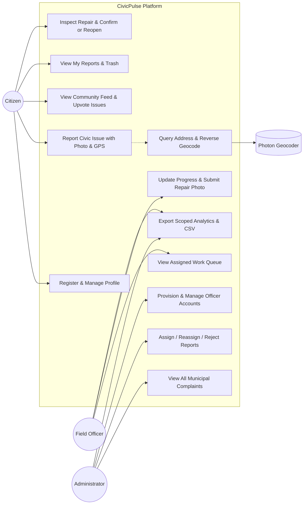
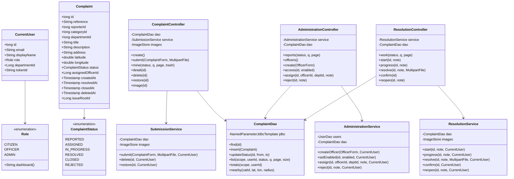
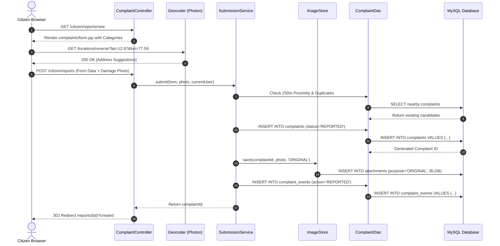
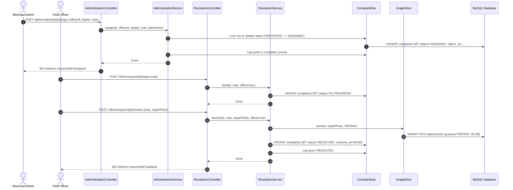
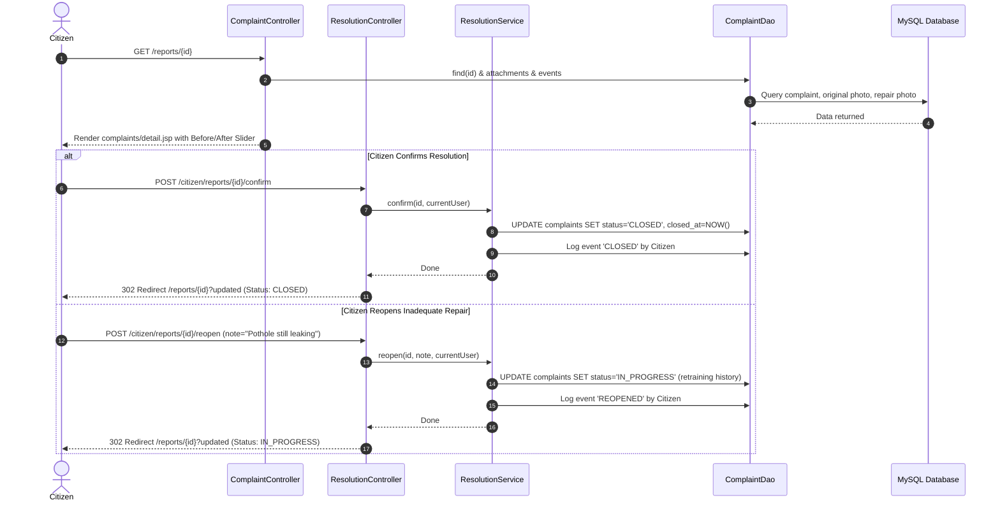
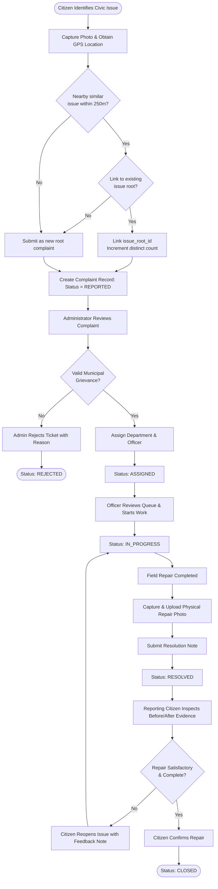
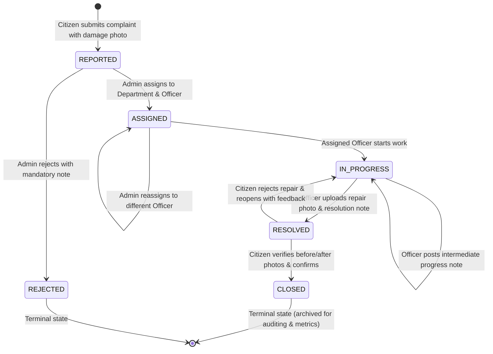
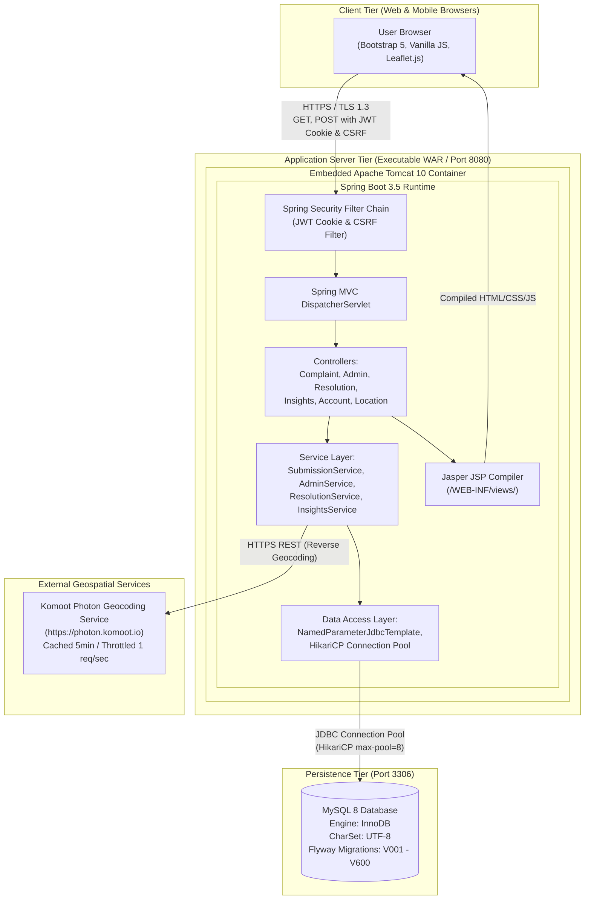

# Project Report & UML Architectural Specification
## CivicPulse: A Transparent, Evidence-Based Municipal Grievance Redressal and Citizen Engagement Platform
### Project-Based Learning (PBL) / Engineering Capstone Comprehensive Report
**Academic Year:** 2025–2026 | **Technology Stack:** Java 17, Spring Boot 3.5, Spring Security, JDBC, MySQL 8, Leaflet, Bootstrap 5

---

## Executive Summary & Abstract
Municipal grievance redressal mechanisms in modern urban governance frequently suffer from opacity, bureaucratic delays, ghost resolutions (tickets closed without actual repair), and duplicate issue reporting. **CivicPulse** is an enterprise-grade, responsive Java web application engineered to bridge the trust gap between citizens, municipal field officers, and administrative authorities.

CivicPulse introduces:
1. **Photographic Evidence Mandate**: Requires initial photo capture by citizens and physical repair proof photos by municipal officers.
2. **Citizen-Driven Verification Gate**: Eliminates self-certification by field workers; only the reporting citizen can close or reopen an issue.
3. **Spatial Intelligence & Proximity Clustering**: Integrates Leaflet.js with the Komoot Photon geocoding engine to suggest nearby existing reports (within 250m) and link duplicates (within 150m), elevating community priority based on distinct reporting citizens.
4. **Resilient Monolithic Architecture**: Delivered as an executable WAR running embedded Apache Tomcat 10 with JSP/JSTL rendering, Flyway database versioning, JWT cookie-based session management with server-side revocation, and strict CSRF and SQL-injection hardening.

---

## Chapter 1: Introduction & Problem Statement

### 1.1 Context and Background
Urban civic infrastructure—ranging from road asphalt, storm-water drainage, and garbage clearance to functioning streetlights and clean water supply—directly dictates public safety and quality of life. Traditional civic complaint channels (paper forms, telephone helplines, or basic web portals) lack photographic evidence, location precision, and accountability.

### 1.2 Limitations of the Existing System
- **Ghost Closures**: Field workers mark issues "Resolved" without photographic verification or on-site inspections.
- **Duplicate Grievance Inundation**: Multiple citizens reporting the same pothole create separate disconnected tickets, overwhelming departmental queues.
- **Lack of Verification Power for Citizens**: Once marked completed by staff, citizens cannot challenge inadequate repairs without submitting entirely new complaints.
- **Privacy vs Transparency Conflicts**: Many existing platforms inadvertently expose citizen phone numbers and home addresses to the general public.

### 1.3 The Proposed Solution: CivicPulse
CivicPulse solves these challenges through:
- **Photographic Accountability**: Enforces upload of original condition photos and post-repair evidence photos with an interactive before/after slider.
- **Citizen Final Approval**: Citizens inspect repair evidence and either confirm closure (`CLOSED`) or reopen the complaint (`IN_PROGRESS`).
- **Community Feed & Prioritization**: Public feed displays issues with color-coded severity (Green = 1 reporter, Yellow = 2–4 reporters, Red = 5+ reporters) without compromising citizen privacy.
- **Recoverable Soft Deletion**: Eliminates accidental record loss while keeping submitted data immutable.

---

## Chapter 2: Literature Survey & Comparative Analysis

| Feature | Traditional Municipal Helplines | Commercial Tools (e.g., SeeClickFix) | Government Apps (e.g., Swachhata) | **CivicPulse (Version 1.1.0)** |
|---|---|---|---|---|
| **Repair Evidence** | None (Verbal note) | Optional Officer Photo | Single Photo Upload | **Mandatory Before & After Photo Comparison Slider** |
| **Citizen Verification** | None (Admin closes) | None (Staff closes) | Feedback Rating (1–5 Stars) | **Citizen Closure Gate (Confirm or Reopen to In-Progress)** |
| **Deduplication** | Manual sorting | Manual merge | Basic GPS grouping | **Automatic 250m proximity detection & 150m explicit linking** |
| **Priority Metric** | Arbitrary / First-Come | Staff manual triage | Upvotes only | **Algorithmic priority weighted by distinct citizen reporters** |
| **Data Privacy** | Poor (Often exposed) | Moderate | Moderate | **Strict separation: zero private PII shared in public feeds** |
| **Deployment Model** | Proprietary SaaS | Multi-tenant SaaS | Government Cloud | **Self-contained Executable WAR on Java 17 / MySQL 8** |

---

## Chapter 3: System Analysis & Feasibility Study

### 3.1 Technical Feasibility
The platform utilizes established, battle-tested open-source enterprise technologies:
- **Java 17 LTS**: Provides memory management, strong type-safety, and pattern matching.
- **Spring Boot 3.5 & Spring Security 6**: Enterprise authentication, role-based access control, and CSRF protection.
- **Leaflet 1.9 & Photon Geocoder**: OpenStreetMap-based zero-licensing mapping stack with in-memory caching and request throttling.
- **MySQL 8**: ACID-compliant transaction engine with row-level locking for concurrent workflow transitions.

### 3.2 Operational Feasibility
CivicPulse requires no proprietary mobile client installation. It operates as a fully responsive Web App accessible from smartphones, tablets, and desktop workstations.

### 3.3 Economic Feasibility
By avoiding paid third-party proprietary mapping APIs (e.g., Google Maps API) and closed SaaS licenses, CivicPulse can be deployed by municipal bodies at zero software license cost.

---

## Chapter 4: Complete UML Architectural Design & Diagrams

### 4.1 Use Case Diagram
The Use Case Diagram defines the interactions between the three primary human actors (**Citizen**, **Officer**, **Administrator**) and the external **Photon Geocoding Service**.



---

### 4.2 Class Diagram
The Class Diagram illustrates the object-oriented structure across controllers, services, repositories (DAOs), and domain transfer models.



---

### 4.3 Sequence Diagrams

#### 4.3.1 Sequence Diagram 1: Citizen Issue Reporting with Camera & Geolocation


---

#### 4.3.2 Sequence Diagram 2: Admin Assignment & Officer Repair Workflow


---

#### 4.3.3 Sequence Diagram 3: Citizen Verification (Confirm Closure vs Reopen)


---

#### 4.3.4 Sequence Diagram 4: Authentication, Cookie JWT & Revocation
```mermaid
sequenceDiagram
    autonumber
    actor User as Client Browser
    participant AuthCtrl as AuthController
    participant AuthSvc as AuthService
    participant JwtSvc as JwtTokenService
    participant SessionDao as LoginSessionDao
    participant DB as MySQL Database

    User->>AuthCtrl: POST /login (email, password)
    AuthCtrl->>AuthSvc: authenticate(loginForm)
    AuthSvc->>DB: SELECT * FROM users WHERE email=?
    DB-->>AuthSvc: User Record & BCrypt Password Hash
    AuthSvc->>AuthSvc: Validate BCrypt hash
    AuthSvc->>SessionDao: createSession(userId, tokenId, expiry)
    SessionDao->>DB: INSERT INTO login_sessions VALUES (...)
    AuthSvc->>JwtSvc: generateToken(user, tokenId)
    JwtSvc-->>AuthSvc: Signed JWT String
    AuthSvc-->>AuthCtrl: AuthCookie
    AuthCtrl-->>User: Set-Cookie: civic_jwt=...; HttpOnly; SameSite=Lax; Path=/

    Note over User, AuthCtrl: Subsequent Requests validate JWT & Session

    User->>AuthCtrl: POST /logout
    AuthCtrl->>SessionDao: revoke(user.tokenId)
    SessionDao->>DB: UPDATE login_sessions SET revoked=TRUE WHERE token_id=?
    AuthCtrl-->>User: Clear-Cookie: civic_jwt; Redirect /login
```

---

### 4.4 Activity Diagram: End-to-End Complaint Lifecycle
The Activity Diagram details the branching decisions and transition flow across roles from submission to closure or rejection.



---

### 4.5 State Machine Diagram: Complaint Entity
The State Machine Diagram formalizes all valid lifecycle state transitions, guard conditions, and triggers.



---

### 4.6 Entity-Relationship (ER) Diagram
The ER Diagram details all tables, fields, data types, primary keys, foreign keys, and cardinalities established through Flyway migrations V001 to V600.

```mermaid
erDiagram
    DEPARTMENTS ||--o{ USERS : "employs"
    DEPARTMENTS ||--o{ CATEGORIES : "governs"
    DEPARTMENTS ||--o{ COMPLAINTS : "routed_to"
    USERS ||--o{ LOGIN_SESSIONS : "authenticates"
    USERS ||--o| ACCOUNT_PROFILES : "owns"
    USERS ||--o{ COMPLAINTS : "reports"
    USERS ||--o{ COMPLAINTS : "assigned_to"
    USERS ||--o{ COMPLAINT_EVENTS : "acts_in"
    USERS ||--o{ ATTACHMENTS : "uploads"
    USERS ||--o{ COMPLAINT_SUPPORTS : "supports"
    USERS ||--o{ ADMINISTRATION_EVENTS : "performs_or_targets"
    CATEGORIES ||--o{ COMPLAINTS : "classifies"
    COMPLAINTS ||--o{ COMPLAINT_EVENTS : "contains"
    COMPLAINTS ||--o{ ATTACHMENTS : "attaches"
    COMPLAINTS ||--o{ COMPLAINT_SUPPORTS : "receives"
    COMPLAINTS ||--o{ COMPLAINTS : "links_root"

    DEPARTMENTS {
        BIGINT id PK
        VARCHAR name UK
        BOOLEAN enabled
    }

    USERS {
        BIGINT id PK
        VARCHAR display_name
        VARCHAR email UK
        VARCHAR password_hash
        VARCHAR role
        BOOLEAN enabled
        BIGINT department_id FK
        TIMESTAMP created_at
    }

    LOGIN_SESSIONS {
        VARCHAR token_id PK
        BIGINT user_id FK
        TIMESTAMP expires_at
        BOOLEAN revoked
    }

    ACCOUNT_PROFILES {
        BIGINT user_id PK, FK
        DATE date_of_birth
        VARCHAR phone
        VARCHAR address
        VARCHAR city
        VARCHAR postal_code
        VARCHAR neighbourhood
        VARCHAR language
        VARCHAR theme
        DOUBLE home_latitude
        DOUBLE home_longitude
    }

    CATEGORIES {
        BIGINT id PK
        VARCHAR name UK
        BIGINT department_id FK
    }

    COMPLAINTS {
        BIGINT id PK
        VARCHAR reference UK
        BIGINT reporter_id FK
        BIGINT category_id FK
        BIGINT department_id FK
        BIGINT assigned_officer_id FK
        BIGINT issue_root_id FK
        VARCHAR title
        VARCHAR description
        VARCHAR address
        DOUBLE latitude
        DOUBLE longitude
        VARCHAR status
        TIMESTAMP created_at
        TIMESTAMP updated_at
        TIMESTAMP resolved_at
        TIMESTAMP closed_at
        TIMESTAMP deleted_at
    }

    COMPLAINT_EVENTS {
        BIGINT id PK
        BIGINT complaint_id FK
        BIGINT actor_id FK
        VARCHAR action
        VARCHAR from_status
        VARCHAR to_status
        VARCHAR note
        TIMESTAMP created_at
    }

    ATTACHMENTS {
        BIGINT id PK
        BIGINT complaint_id FK
        BIGINT uploader_id FK
        VARCHAR purpose
        VARCHAR content_type
        MEDIUMBLOB image_data
        TIMESTAMP created_at
    }

    COMPLAINT_SUPPORTS {
        BIGINT complaint_id PK, FK
        BIGINT citizen_id PK, FK
        TIMESTAMP created_at
    }

    ADMINISTRATION_EVENTS {
        BIGINT id PK
        BIGINT actor_id FK
        BIGINT subject_id FK
        VARCHAR action
        VARCHAR note
        TIMESTAMP created_at
    }
```



---

### 4.7 Component & Deployment Diagram
Visualizes the deployment layout, network protocols, server tiers, and file system packaging.



---

## Chapter 5: Implementation Details & Key System Components

### 5.1 Project Directory Structure & Modular Layout
CivicPulse adheres to a multi-folder ownership structure compiled through a single Maven build:
- `database/module 5`: Relational schema migrations (`V001__foundation.sql` to `V600__report_deletion_and_issue_links.sql`).
- `frontend/module 1`: Public portal, citizen reporting JSPs, Leaflet map initialization, bilingual translations dictionary (`translations.js`), and core stylesheet tokens.
- `frontend/module 2`: Admin command center, officer work queue, and before/after repair comparison slider scripts.
- `backend/module 3`: Spring Boot configuration, authentication, JWT tokens, account profile management, reporting submission engine, and community insights.
- `backend/module 4`: Administrative assignment, officer resolution workflow, and cross-module integration tests.

### 5.2 Secure Session Handling via Stateless JWT Cookie
Instead of vulnerable `localStorage` tokens or heavyweight server sessions, CivicPulse utilizes an `HttpOnly`, `SameSite=Lax` cookie storing a signed HMAC-SHA256 JWT. Server-side logout or account deactivation immediately revokes the token UUID in the `login_sessions` table, combining stateless scalability with instant revocation capability.

### 5.3 Spatial Calculations & Haversine Distance
Candidate proximity detection evaluates reports within 250 meters using bounding box coordinate pre-filtering followed by the precise Haversine formula in Java:
```java
public static double haversine(double lat1, double lon1, double lat2, double lon2) {
    double R = 6371000; // Earth radius in meters
    double phi1 = Math.toRadians(lat1);
    double phi2 = Math.toRadians(lat2);
    double deltaPhi = Math.toRadians(lat2 - lat1);
    double deltaLambda = Math.toRadians(lon2 - lon1);
    double a = Math.sin(deltaPhi / 2) * Math.sin(deltaPhi / 2)
            + Math.cos(phi1) * Math.cos(phi2)
            * Math.sin(deltaLambda / 2) * Math.sin(deltaLambda / 2);
    return R * 2 * Math.atan2(Math.sqrt(a), Math.sqrt(1 - a));
}
```

### 5.4 Canonical Image Storage in Relational Database
Images are converted to canonical PNG format and saved as `MEDIUMBLOB` directly in the `attachments` table. This prevents file path traversal vulnerabilities, eliminates file-system synchronization bugs across server clusters, and enforces row-level access control on image reads (`/reports/images/{id}`).

---

## Chapter 6: Software Testing & Quality Assurance

### 6.1 Testing Methodology
The system underwent rigorous automated and manual test suites:
- **Unit & DAO Tests**: Parameter binding, validation annotations, and SQL constraint compliance.
- **MockMvc & Web Integration Tests**: `FoundationIntegrationTest`, `ProfileIntegrationTest`, and `CitizenExperienceIntegrationTest`.
- **Smoke Tests**: Verifying compiled JSP execution within the live executable WAR (addressing the known limitation where MockMvc does not compile JSPs).
- **Security & Vulnerability Tests**: CSRF token validation, IDOR protection on attachments, and CSV formula neutralization.

### 6.2 Test Results Matrix

| Test Suite / Test Case | Scope / Component | Execution Target | Result | Evidence File |
|---|---|---|---|---|
| **FoundationIntegrationTest** | Authentication, BCrypt, JWT, Session Revocation | H2 / MySQL | **PASSED** (14 checks) | `AUTOMATED_RESULTS_1.1.json` |
| **ProfileIntegrationTest** | Preferences, Hindi/English, Home Coordinates | Database Module | **PASSED** (8 checks) | `PREFERENCE_RESULTS_1.1.json` |
| **CitizenExperienceIntegrationTest** | End-to-end lifecycle (Submit -> Assign -> Resolve -> Reopen) | Backend Modules 3 & 4 | **PASSED** (11 checks) | `AUTOMATED_RESULTS_1.1.json` |
| **Executable WAR Smoke Test** | Real JSP compilation on embedded Tomcat | Live WAR Port 8080 | **PASSED** (26 endpoints) | `WAR_SMOKE_RESULTS_1.1.json` |
| **Responsive Browser Verification** | Mobile viewport (375px) vs Desktop (1440px) | UI Components | **PASSED** (0 overflow) | `BROWSER_RESULTS_1.1.json` |
| **CSV Neutralization Verification** | Formula injection payloads (`=CMD`, `@SUM`) | Insights Export | **PASSED** (Sanitized) | `TEST_RESULTS_1.1.md` |

---

## Chapter 7: Results & User Interface Walkthrough

### 7.1 Citizen Interface
- **Dashboard & My Reports**: Shows real-time counts of Reported, In-Progress, Resolved, and Closed items with search and status filtering.
- **Reporting Modal**: Provides live Leaflet pin placement, Photon reverse-geocoding, camera capture with automatic geolocation query, and file size validation.
- **Community Feed & Priority Map**: Displays issues with colored badges (Red = High Priority / 5+ citizens; Yellow = Medium; Green = Low) and visual 75m impact radius markers.

### 7.2 Administrative Command Center
- **Grievance Dispatch Queue**: One-click assignment to registered department officers or rejection with formal notes.
- **Officer Management**: Secure provisioning of field staff with instant access toggling.
- **Performance Analytics**: Real-time MTTR (Mean Time to Resolution) calculations and sanitized CSV downloads.

### 7.3 Field Officer Resolution Center
- **Work Queue**: Filtered exclusively to tickets assigned to the logged-in officer.
- **Repair Submission**: Uploads physical repair photos with work completion notes.

---

## Chapter 8: Conclusion, Limitations & Future Work

### 8.1 Conclusion
CivicPulse (Version 1.1.0) successfully demonstrates how modern software engineering principles and architectural rigor can solve real-world civic governance challenges. By enforcing photographic evidence, empowering citizens as the final verification authority, and employing spatial deduplication, the platform eliminates ghost closures and optimizes municipal resource allocation.

### 8.2 Limitations
1. **External Geocoding Dependency**: Relies on public Photon geocoding endpoints; production enterprise deployments should self-host a dedicated Photon instance.
2. **Database Storage Scale**: Storing multi-megabyte image BLOBs directly in MySQL requires disciplined database backups and binary log maintenance.
3. **Network Latency in Remote Areas**: High-resolution image uploads require reliable cellular connectivity.

### 8.3 Future Enhancements
- **AI-Powered Image Verification**: Integrating computer vision models (e.g., TensorFlow Lite or OpenCV) to automatically detect whether an uploaded photo actually depicts a pothole or garbage heap before submission.
- **Push Notifications & SMS Gateways**: Integrating automated SMS alerts (via Twilio or government SMS gateways) to notify citizens when an officer is dispatched.
- **Offline Progressive Web App (PWA)**: Adding Service Workers and IndexedDB to allow citizens to capture photos offline and auto-sync when network connectivity is restored.

---

## References
1. IEEE Std 830-1998: *IEEE Recommended Practice for Software Requirements Specifications*.
2. Pressman, R. S., & Maxim, B. R. (2020). *Software Engineering: A Practitioner's Approach* (9th ed.). McGraw-Hill Education.
3. Walls, C. (2022). *Spring in Action* (6th ed.). Manning Publications.
4. Leaflet Developers (2024). *Leaflet: An open-source JavaScript library for mobile-friendly interactive maps*. https://leafletjs.com/
5. Komoot Photon (2024). *Photon Geocoder Documentation*. https://photon.komoot.io/
